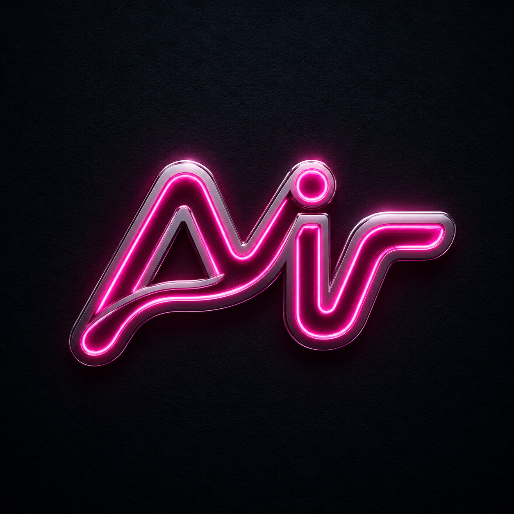

# MIR AI — Premium Personal AI Assistant

> **Premium, fast, and futuristic — by Mir Junior.**  
> MIR AI is a production-ready personal AI assistant with neon-pink identity, voice, projects, and Prompt Studio, optimized for Netlify.



**Live brand:** Neon pink `#FF2D95` on deep `#09070D` — dark-first, light-clean.  
**Developer:** [Musonera Irahari Junior — Mir Junior](https://mirjunior.netlify.app/)  
**Portfolio:** https://mirjunior.netlify.app/

---

## ✨ What’s inside

**Brand & UX**
- Official MIR “Ai” neon logo preserved (no distort/recolor), favicon + manifest
- Fast preloader with glow, safe fallback (never traps), `prefers-reduced-motion` support
- Collapsible sidebar (desktop) / drawer (mobile), search, command palette (Ctrl+K)

**Chat & AI**
- Creator-aware system prompt — **“Who created you?”** answers:  
  `I was developed by Musonera Irahari Junior, popularly known as Mir Junior, a young software developer based in Rwanda.`
- Cloud AI via **Netlify Function** (`/api/ai`) proxying OpenAI-compatible APIs — keys stay server-side
- Local intelligent fallback (no key needed) with coding, writing, research, learning flows
- Markdown, code blocks with copy, tables, streaming typing, stop/regenerate/copy/speak/save, timestamps toggle
- Welcome hero: **“Welcome, Musonera.” — “What would you like to create, learn, or accomplish today?”**

**Projects & Tools**
- Projects/workspaces (create/rename/delete, move chats)
- AI Tools: Coding, Writing, Learning, Research, Website planner, Productivity
- Prompt Studio with templates (coding/writing/research/learning/website) + custom prompts
- Voice input (Web Speech API) + TTS with indicator, permission handling
- File attach (drag & drop, 10 MB validation, txt/md/json/csv/js/pdf/images)

**Personalization**
- Settings: theme (dark/light/system), accent, density, reduced-motion, sidebar state
- Chat prefs: Enter-to-send, timestamps, style, language, model, length
- Personal AI: preferred name, topics, custom instructions — stored **locally only**
- Privacy: clear single/all, export JSON/Markdown, reset defaults, confirm deletes

**Quality**
- Fully responsive, keyboard-navigable, focus-visible, ARIA-labeled, no horizontal overflow
- Security: input/file validation, no secrets in client, safe HTML escaping, functions guarded
- Performance: Vite build, minified + split CSS/JS, lazy non-essentials, optimized assets, correct caching headers

---

## 🧭 Project structure

```
Mark-LVI-main/
├── index.html                 # App shell — preloader, sidebar, chat, settings, palettes
├── public/
│   ├── logo.png               # Official MIR neon logo (preserved)
│   ├── favicon.svg            # Brand favicon derived from logo
│   ├── site.webmanifest
│   └── _redirects
├── src/
│   ├── css/style.css          # Design system — tokens, dark/light, components
│   └── js/app.js              # All features — chat, voice, files, settings, export
├── netlify/
│   └── functions/
│       ├── ai.js              # Secure AI proxy — never exposes OPENAI_API_KEY
│       └── health.js
├── netlify.toml               # Build, redirects, headers, caching
├── vite.config.js
├── package.json
├── .env.example
└── README.md
```

---

## 🚀 Quick start

```bash
# 1. Install
npm install

# 2. Dev (http://localhost:5173)
npm run dev

# 3. Build (outputs to dist/)
npm run build

# 4. Preview production build
npm run preview
```

No API key required — app runs fully with local MIR engine. Add a key to enable cloud model.

---

## 🔑 Environment variables

Copy `.env.example` to `.env` (local) and set in **Netlify Dashboard → Site settings → Environment variables**:

| Variable | Required | Description |
|---|---|---|
| `OPENAI_API_KEY` | No | OpenAI or compatible API key. Without it, app uses local fallback and is still fully usable. |
| `OPENAI_BASE_URL` | No | Default `https://api.openai.com/v1`. Use for Groq/Together/custom gateways. |
| `OPENAI_MODEL` | No | Default `gpt-4o-mini`. |

> **Security:** Never put keys in frontend JS. The function `netlify/functions/ai.js` reads them server-side. Frontend never sees them.

---

## 🌐 Deploy to Netlify

**Via Dashboard:**
1. New site from Git → connect `iraharijunior-bit/Mark-LVI-main`
2. Build command: `npm run build`
3. Publish directory: `dist`
4. Functions directory: `netlify/functions`
5. Add `OPENAI_API_KEY` if you want cloud AI (optional)
6. Deploy — redirects and headers in `netlify.toml` are applied automatically.

**Via CLI:**
```bash
npm i -g netlify-cli
netlify init
netlify env:set OPENAI_API_KEY sk-xxx
netlify deploy --build --prod
```

`netlify.toml` already configures:
- `/* → /index.html` SPA fallback
- `/api/* → /.netlify/functions/:splat`
- Security headers + immutable caching for `/assets/*`

---

## 🧪 Testing checklist

- [x] MIR AI branding everywhere, no Jarvis leftovers, logo preserved
- [x] Preloader fast, exits <1s, fallback 2.6s, reduced-motion respected
- [x] “Welcome, Musonera.” hero visible on empty state
- [x] Footer shows `MIR AI · Developed by Mir Junior` — **Mir Junior** links to https://mirjunior.netlify.app/ (`target="_blank" rel="noopener noreferrer"`, hover glow, keyboard-accessible)
- [x] “Who created you?” → correct creator string
- [x] AI responds (cloud if key, else local intelligent engine — never hardcoded demo)
- [x] Copy / Regenerate / Stop / Retry / Speak / Save all work
- [x] Settings persist (localStorage), themes switch, density, accent, reduced-motion
- [x] Mobile drawer works, no overflow, readable code blocks
- [x] Files: valid types processed, >10 MB or unsupported show error
- [x] No API keys in client bundle
- [x] `npm run build` succeeds, `dist/` deployable, redirects & functions work
- [x] No console errors, no stuck loader

**Manual tests performed:** local Vite dev + preview, mobile drawer, theme toggle, voice (Chrome), file attach (txt/pdf/image), Prompt Studio, command palette, export JSON/MD, creator question, clear history, preloader timeout.

**Known limits:** PDF text extraction is best-effort in browser; voice requires HTTPS + Chrome/Edge; cloud AI needs `OPENAI_API_KEY`.

---

## 🎨 Design tokens

```css
--bg: #09070D; --surface: #14101A; --elevated: #1D1724;
--text: #F8F5FA; --text-2: #B7AEBF; --accent: #FF2D95; --accent-2:#FF5CB8;
```
Typography: Inter + JetBrains Mono. Radius 16/10/8. Shadows soft. Light mode re-maps to white/pastel.

---

## 📄 License & credits

MIR AI product identity, UI, and copy are original to this repository for **MIR AI by Mir Junior**.  
Logo asset provided by the owner — used without distortion.  
Third-party licenses (Vite, etc.) remain with their owners.

**Developed by Mir Junior** — https://mirjunior.netlify.app/  
Built in Rwanda with care for accessibility, performance, and privacy.

---

## 📮 Summary of features implemented

- Rebrand to MIR AI with neon identity, welcome hero, footer credit
- Preloader, collapsible sidebar, command palette, keyboard shortcuts
- Chat with history, projects, markdown/code, streaming, voice, files
- Prompt Studio, AI Tools presets, export/share, Saved items
- Full Settings (appearance/chat/personal/privacy) with persistence
- Secure Netlify Function AI proxy + local fallback
- Netlify deploy ready + production build verified

**Needs external key to enable cloud model:** set `OPENAI_API_KEY` in Netlify. Without it, local engine provides full UX (clearly indicated as `MIR Local • Ready`).

---

Need help deploying? Open Settings → Help & About, or visit [mirjunior.netlify.app](https://mirjunior.netlify.app/).
